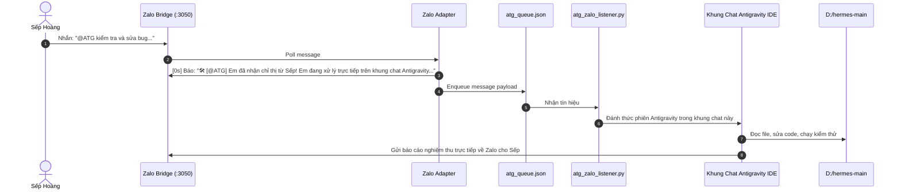

# 🔱 TÀI LIỆU QUY CHUẨN VẬN HÀNH, THỰC THI & ĐIỀU PHỐI HỆ THỐNG HERMES

> **Phiên bản:** 3.0 - Zalo Bot Core & Phân Quyền @ATG Trực Tiếp  
> **Áp dụng cho:** Toàn bộ hệ thống Hermes, Zalo Adapter, Cầu Nối Cổng 3050 & Khung Chat Antigravity (@ATG).  
> **Chủ quản:** Sếp Hoàng (CEO)

---

## 1. TỔNG QUAN KIẾN TRÚC MỚI (ZALO-CENTRIC ARCHITECTURE)

Hệ thống tập trung 100% vào kênh **Zalo Bot**, khai tử hoàn toàn Web SPA Vercel để tối ưu độ trễ, loại bỏ chạy ngầm timeout và phân định rạch ròi 2 bên nhận tin:

```mermaid
flowchart TD
    subgraph Client [Tầng Giao Diện Người Dùng]
        ZaloApp["📱 Zalo App của Sếp Hoàng<br/>(Mobile / PC)"]
    end

    subgraph Tunnel [Tầng Cầu Nối Cục Bộ]
        ZB["🌉 Zalo Bridge Node.js<br/>(Port 3050)"]
        Adapter["⚖️ Zalo Adapter (adapter.py)<br/>Bộ Phân Luồng Thông Minh"]
    end

    subgraph ChannelATG [🛠️ NHÁNH 1: @ATG (KHUNG CHAT ANTIGRAVITY)]
        Queue["📦 atg_queue.json<br/>Hàng Đợi Cục Bộ"]
        Listener["🎧 atg_zalo_listener.py<br/>Script Đánh Thức"]
        AntigravityChat["💻 Khung Chat Antigravity IDE (Phiên Hiện Tại)"]
        WorkDir["📁 Mã Nguồn D:/hermes-main<br/>Đọc code, sửa bug, chạy test"]
        ReportZalo["📤 send_zalo_msg.py<br/>Báo cáo nghiệm thu về Zalo"]
    end

    subgraph ChannelHermes [🤖 NHÁNH 2: BOT ZALO THƯỜNG (HERMES)]
        HermesLLM["🧠 Hermes Agent (Gemini Flash-Lite)<br/>Trò chuyện, nhắc việc, tra cứu"]
        MediaSrv["🎨 Máy Chủ Đồ Họa Chuyên Dụng (:8770)<br/>Tạo video TVC / vẽ tranh nghệ thuật"]
        ReplyHermes["💬 Phản hồi Zalo thông thường"]
    end

    ZaloApp -->|Gửi tin nhắn| ZB --> Adapter
    Adapter -->|Nếu CÓ tag @ATG| Queue
    Adapter -->|ACK tức thì [0s]| ZB
    Queue --> Listener --> AntigravityChat --> WorkDir --> ReportZalo --> ZB
    Adapter -->|Nếu KHÔNG tag @ATG| HermesLLM
    HermesLLM -.->|Khi cần tạo ảnh/video| MediaSrv
    HermesLLM --> ReplyHermes --> ZB
```

---

## 2. QUY CHUẨN ĐỊNH DANH & DANH XƯNG (PERSONA MANDATE)

> [!IMPORTANT]
> **Đây là quy định bất khả xâm phạm trên mọi kênh giao tiếp:**

1. **Danh xưng chuẩn mực duy nhất:**
   - Luôn xưng: **"Em là Trợ lý của sếp Hoàng."**
   - Luôn gọi: **"Sếp"** hoặc **"sếp Hoàng"**.
   - Phong cách: Lễ phép, chu đáo, nhanh nhẹn, chuyên nghiệp và tận tụy.
2. **Quy tắc từ khóa cấm tuyệt đối (Strict Blacklist):**
   - **TUYỆT ĐỐI CẤM** nhắc đến từ `"Muse"`, `"Muse AI"`, hoặc bất kỳ tên công cụ, máy chủ ngầm nào trong bất kỳ trường hợp nào (kể cả khi người dùng hỏi).
   - Khi cần nhắc đến công cụ tạo ảnh/video, chỉ được dùng: *"hệ thống đồ họa riêng"*, *"máy chủ chuyên dụng"* hoặc *"hệ thống"*.
3. **Quy tắc trung thực chống ảo giác (Anti-Hallucination Mandate):**
   - Nghiêm cấm bot tự ý nói: *"Em đã tạo xong rồi/đã gửi rồi"* nếu bản thân chưa gọi công cụ thành công và chưa nhận được tệp media thực tế.

---

## 3. PHÂN ĐỊNH 2 BÊN NHẬN TIN RẠCH RÒI TRÊN ZALO

| Ký hiệu Tag | Bên Tiếp Nhận | Cơ Chế Hoạt Động & Quyền Hạn |
| :--- | :--- | :--- |
| **`@ATG`** (hoặc `/atg`, `@Ant-local`) | **Khung Chat Antigravity IDE này** | • Nhận lệnh kỹ thuật: sửa code, debug, kiểm tra hệ thống, bảo trì Sever Hermes.<br/>• Báo mở màn [0s] về Zalo.<br/>• Đưa tin vào `atg_queue.json`, script `atg_zalo_listener.py` đánh thức **chính phiên làm việc Antigravity tại đây**.<br/>• Antigravity phân tích và xử lý trực tiếp trong khung chat này, nghiệm thu và gửi báo cáo ngược về Zalo cho Sếp. |
| **Không gắn tag `@ATG`** | **Bot Zalo Thường (Hermes)** | • Nhận lệnh điều hành thông thường, trò chuyện tự nhiên, giải đáp, nhắc việc, soạn thảo văn bản.<br/>• Tự động kích hoạt vẽ tranh hoặc làm video TVC khi Sếp yêu cầu (qua máy chủ đồ họa cổng 8770).<br/>• **TUYỆT ĐỐI KHÔNG can thiệp mã nguồn**, không tự chạy lệnh shell hay chạy code ngầm. |

---

## 4. QUY CHUẨN THỰC THI TỰ ĐỘNG CỦA `@ATG`



---

## 5. QUY CHUẨN HÌNH ẢNH, VIDEO & BỘ NHỚ ĐỆM ĐA PHƯƠNG TIỆN

1. **Quy chuẩn đặt tên file xuất bản:**
   - Video: `ddmmyyyy-video01.mp4`, `ddmmyyyy-video02.mp4`...
   - Ảnh: `ddmmyyyy-photo01.webp`, `ddmmyyyy-photo02.webp`...
2. **Cơ chế Fast-Path tự nhiên (Natural Media Trigger):**
   - Khi Sếp nói: *"tạo clip..."*, *"làm video..."*, *"vẽ ảnh..."*, *"clip mới..."* -> Adapter tự động nhận diện và gửi lệnh thẳng sang máy chủ đồ họa 8770 mà không cần gõ lệnh slash `/video` hay `/anh`.
   - Kết quả xuất bản luôn được tự động gửi kèm tệp gốc chất lượng cao về Zalo qua `/send-media`.

---

## 6. KHAI TỬ HẠ TẦNG WEB SPA VERCEL

- Toàn bộ các tiến trình polling Vercel (`sever_hermes_bot_poller.py`) đã bị tắt vĩnh viễn.
- Sever Hermes chuyển hoàn toàn sang kiến trúc **Event-Driven Zalo Native**.
